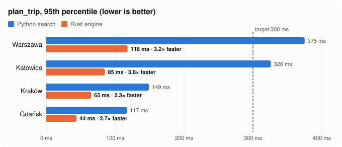
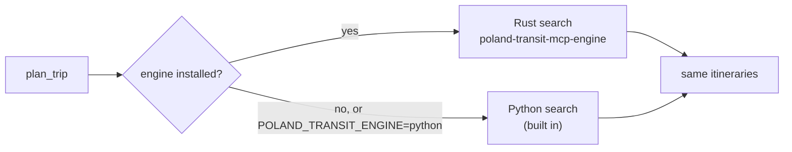
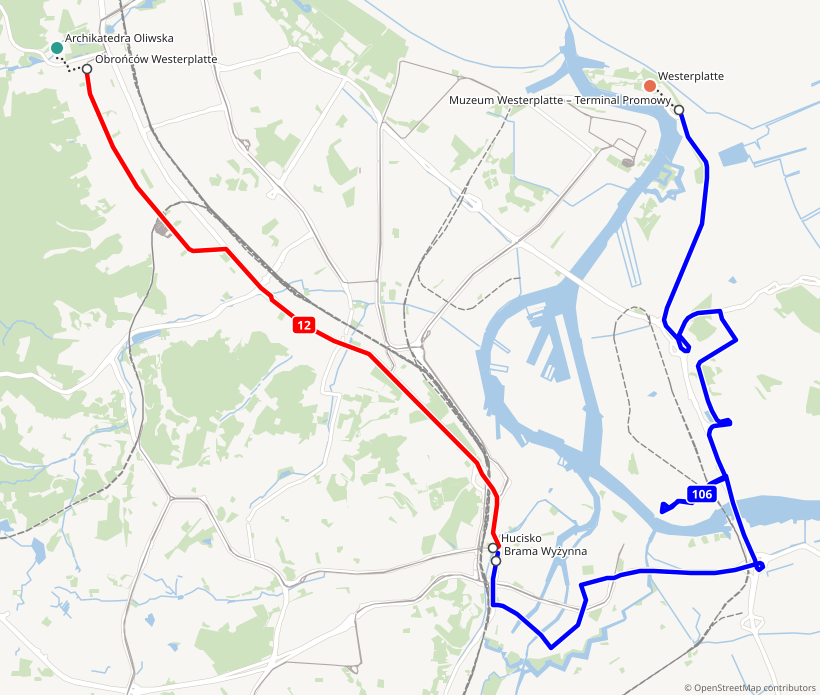

<div align="center">

# poland-transit-mcp

**An MCP server for getting around Polish cities: places, walking routes, timetables and door-to-door trip plans.**
Built on OpenStreetMap and the operators' official GTFS timetables. Each answer names its sources and data dates.




**Warszawa · Kraków · Katowice (GZM) · Wrocław · Poznań · Gdańsk · Lublin · Toruń · Zakopane**<br>
and between them by train (13 rail operators) or FlixBus

</div>

## Quick start

City data is not in git and no prebuilt download is published yet, so you build the cities you need from the
official sources. You need [uv](https://docs.astral.sh/uv/) and `osmium-tool` (macOS: `brew install uv osmium-tool`;
Debian/Ubuntu: `sudo apt-get install -y osmium-tool`). Gdańsk takes about 2 minutes, including downloads.

```bash
git clone https://github.com/alexratmanpl/poland-transit-mcp.git && cd poland-transit-mcp
uv sync
uv run poland-transit-mcp build gdansk --download     # writes data/cities/gdansk.sqlite (git ignores data/)
uv run python scripts/smoke.py                        # expect: PASS
claude mcp add poland-transit -- "$PWD/.venv/bin/poland-transit-mcp" --cities gdansk --data-dir "$PWD/data/cities" --no-download
```

**[AGENTS.md](AGENTS.md) is the full guide:** the optional Rust engine, more cities, trips between cities,
memory settings, Claude Desktop and other clients, troubleshooting and every flag.

<details>
<summary><b>Main options</b></summary>

- `--cities a,b` or `all`: which cities to serve. Add `poland` for trips between cities (trains and FlixBus).
- `--memory-budget 480`: memory target for the whole process, in MB. Cities load on their first query; when the budget is reached, cached dates of the least recently used cities are dropped first, then the least recently used city is unloaded. At start, the server says if your cities need more to stay loaded together, and how much. See [docs/SCALING.md](docs/SCALING.md).
- `--http 8080`: Streamable HTTP on `127.0.0.1:8080/mcp` instead of stdio (`--host 0.0.0.0` in a container; there is no authentication, see [SECURITY.md](SECURITY.md)).
- `--live gdansk`: opt in to ZTM Gdańsk's real-time estimates.
- `OTEL_EXPORTER_OTLP_ENDPOINT=…` with the `otel` extra: traces and metrics to your collector. See [Observability](#observability).
- `--data-dir DIR`, `--no-download`: where city files are, and whether missing ones are fetched. Without `--data-dir` (or `POLAND_TRANSIT_DATA`) a source checkout uses its own `data/cities`, wherever you start the server, and an installed copy uses `~/.cache/poland-transit-mcp`; the working directory is never searched.
</details>

<details>
<summary><b>When prebuilt city files are published</b></summary>

The server can download prebuilt city files from this repository's `data-latest` release on first start.
That release does not exist yet (the download returns HTTP 404). Once it does, this one command will work:

```bash
uvx --from git+https://github.com/alexratmanpl/poland-transit-mcp poland-transit-mcp --cities gdansk,krakow,wroclaw
```
</details>

## Faster with the optional Rust engine

The trip-planning search ([RAPTOR](https://www.microsoft.com/en-us/research/publication/round-based-public-transit-routing/))
is ported line for line to Rust. Install the engine and the server uses it; leave it out and the
built-in Python search answers instead. The answers are the same; only the speed differs.



<sub>`plan_trip` p95 in process, 100 plans per city, on a 4-vCPU cloud VM ([docs/CHECKS.md](docs/CHECKS.md#rust-engine-optional)).</sub>

**Why Rust:**
- **It's where the time goes.** In a profile of 40 Warszawa trip plans with the Python search, the search was 85 % of the time, and in Python `plan_trip` missed the 300 ms target on Warszawa and Katowice.
- **It's much faster, with the same answers.**
  - Each search runs 17–21× faster in Rust. A whole `plan_trip` also spends time outside the search (walking, building the answer), so it is faster by less: in total time over 100 plans, 2.3× on Gdańsk, 3.1× on Warszawa and 3.4× on Katowice (p50 25→8, 79→18 and 78→18 ms). Measured with `scripts/compare_engines.py`, in process, on an Apple Silicon Mac on 2026-11-17 ([docs/CHECKS.md](docs/CHECKS.md#rust-engine-optional)).
  - Rust and Python answers matched in full on 400 real trip plans and on every [acceptance query](docs/CHECKS.md).
- **It runs in parallel.** The engine releases Python's global interpreter lock (GIL), so simultaneous requests over HTTP can use every CPU core.
- **Only the search is Rust.** The MCP server, the tools and the data pipeline stay Python.



The server prints the search it uses at start (`search engine: rust <version>` or `python`) and reports
it in `list_cities`.

Adding the engine today needs a Rust toolchain: `--with ./engine` from a clone, or
`--with "poland-transit-mcp-engine @ git+…#subdirectory=engine"`. Once the engine is published to
PyPI, `--with poland-transit-mcp-engine` installs a prebuilt wheel with no toolchain needed.
Publishing is an optional, manual step: [docs/PUBLISHING.md](docs/PUBLISHING.md).

## Observability

Opt-in OpenTelemetry traces and metrics, sent to any collector (Jaeger, Grafana, Honeycomb…).
One trace per tool call shows where the time went:

```text
tools/call plan_trip ......... 819 ms   ← the MCP SDK's span
└─ tool plan_trip ............ 818 ms   city=gdansk, outcome=ok
   ├─ city.load ×5 ........... 773 ms   first call: the city loads into memory
   ├─ walk.search ×5 .........  13 ms
   └─ routing.search ×6 ...... 2.5 ms   rust
```

```bash
# in your clone, with city files built (Quick start above)
uv sync --extra otel      # list every extra you use: uv sync drops the ones you leave out (e.g. add --extra fast)
OTEL_EXPORTER_OTLP_ENDPOINT=http://localhost:4318 uv run poland-transit-mcp --cities gdansk --no-download
```

- **Metrics:** tool latency per tool and city, search time per engine, city loads and unloads, memory against the budget.
- **Privacy:** no place names, coordinates or query text are recorded. Tests check this.
- **Cost:** off by default and free when off. Exporting adds 1–2 ms per trip plan and up to ~30 MB.

Details and measurements: [docs/OBSERVABILITY.md](docs/OBSERVABILITY.md).

## Between cities

Add the national layer `poland` (trains of 13 operators and FlixBus coaches) and give `plan_trip` a
`to_city`. A real answer, trimmed (Kraków Rynek Główny → Krupówki, Zakopane, Tuesday 08:00):

```text
08:33 → 11:33  walk 17 min to Kraków Główny
               IC 1312/3 Malinowski (PKP Intercity) 08:56 platform 3, track 2 → Zakopane 11:22 platform 2, track 3
               walk 3 min, bus 10 (Zakopane city buses) 11:30 → Krupówki 11:33
09:51 → 12:38  EIC 1350/1 Tatry 10:14 → 12:17, walk 16 min
11:22 → 14:06  FlixBus 1257A from Krakow MDA Bus Station 11:45 → Zakopane Bus Station 13:45, walk 16 min
note: the private Kraków–Zakopane minibuses publish no open timetables and are not included
```

The Zakopane bus leg comes from a local transcription of the city's PDF timetables, which is not published
(see [DATA-LICENSE.md](DATA-LICENSE.md)); your own build gives the walk instead.

Over MCP, between Gdańsk, Kraków and Warszawa: p95 **372 ms** with the Rust engine, every trip found a
connection ([docs/INTERCITY.md](docs/INTERCITY.md)). Build `poland.sqlite` yourself
(`poland-transit-mcp build poland --download`, 12–14 s, no osmium needed); no prebuilt file is published until
Koleje Mazowieckie's reuse terms are read. Its size depends on the day's feeds: 14.5 MB and 20.6 MB in two builds
a few days apart. With three large cities plus `poland`, give it `--memory-budget 700`.

## Tools

Answers are lean by default and the same rule holds on every tool: the default answer holds what a person asking
needs and every id the next call takes; `detail: "full"` adds what only code needs (line geometry, trip ids, colours,
the points of a leg's ends, the full data dates) on `departures`, `line_info`, `walk_route`, `plan_trip` and
`plan_stations`; `limit` gives more rows and filters narrow the question; an answer that was cut says so in `note`.
Each tool's `outputSchema` marks the fields "only with detail=\"full\"", and each `detail` says how much larger the
answer gets. Sizes per tool: [AGENTS.md](AGENTS.md#lean-by-default-more-on-demand).

| Tool | Answers |
|---|---|
| `list_cities` | cities, data dates, features (the server's instructions already name the city ids) |
| `find_places` | attractions, museums, parks, stations, stops, hotels and streets, by name or proximity |
| `stops_near` | stops by **walking time**, with the lines serving each |
| `departures` | scheduled (and opt-in live) departures, with the `operator`; on `poland`, trains with platform and track; with `to`, only the runs that go on to another stop, with their arrival there; `mode` for one kind of vehicle |
| `line_info` | a line's stops, first/last run and frequency (geometry with `detail`); on `poland`, a train by number or name |
| `walk_route` | a walking path that never crosses water except on a bridge |
| `plan_trip` | up to 3 door-to-door itineraries, `depart_at` or `arrive_by`; with `to_city`, between cities by train or FlixBus |
| `plan_stations` | trains and coaches between stations of `poland`: several start and end stops, each with its own minutes before boarding or after arriving (for a caller that brings the traveller to a station itself) |
| `map_extract` / `render_map` | map data for an area; a map image (PNG, or SVG on request) of an area or of a trip by its `trip` reference |



## Measured

4-vCPU Linux cloud VM, Python 3.13, end to end over MCP, 600 random trips. Full method in [docs/CHECKS.md](docs/CHECKS.md#weight).

| | With the Rust engine | Python search only | Budget |
|---|---|---|---|
| `plan_trip` p95, Warszawa + Katowice + Kraków | **89 ms** | 377 ms | < 300 ms |
| `plan_trip` p95, Gdańsk + Wrocław + Kraków | **80 ms** | 169 ms | < 300 ms |
| Peak memory, all 8 cities in one process | **432 MB** | 420 MB | ≤ 512 MB |
| Cold start | 0.8–1.0 s | 0.8–1.1 s | ≤ 3 s |
| City files | 5.7 MB (Zakopane) to 129.9 MB (Warszawa); `poland` 14.5–20.6 MB | | ≤ 150 MB each |
| `plan_trip` between cities, p95 (Gdańsk, Kraków, Warszawa + `poland`, 700 MB) | **372 ms** | 2,013 ms | < 1 s |

## Data, licences, credits

- **Code** is MIT. **City files** are ODbL 1.0 (© OpenStreetMap contributors) for the map, and each timetable keeps its publisher's terms ([DATA-LICENSE.md](DATA-LICENSE.md)). No data is in git.
- **Not cleared for redistribution:** Zakopane's timetable (public sector information, but the transcription is not published, so a build gives map and walking only) and `poland` (Koleje Mazowieckie's terms not yet read; PKP PLK forbids reselling the raw data). You can build them for your own use; no prebuilt file of them will be published until that changes. Details in [DATA-LICENSE.md](DATA-LICENSE.md).
- **Timetables** are from:
  - [ZTM Gdańsk](https://www.ztm.gda.pl/otwarty_ztm)
  - [ZTP Kraków](https://gtfs.ztp.krakow.pl)
  - [UM Wrocław](https://open-data.cui.wroclaw.pl)
  - [ZTM Poznań](https://www.ztm.poznan.pl/otwarte-dane/dla-deweloperow/)
  - [ZTM Warszawa](https://ztm.waw.pl)
  - [ZTM GZM](https://otwartedane.metropoliagzm.pl)
  - Gmina Miasta Toruń and MZK Toruń
  - [ZDiTM Lublin](https://www.zdtm.lublin.eu)
  - [Gmina Miasto Zakopane](https://www.zakopane.pl/komunikacjamiejska/rozklady-jazdy) (PDF timetables, transcribed and checked twice)
- **Trains:** [PKP Polskie Linie Kolejowe S.A.](https://www.plk-sa.pl/klienci-i-kontrahenci/api-otwarte-dane) open railway data, and Koleje Mazowieckie.
- **Coaches:** FlixBus, via [transport.data.gouv.fr](https://transport.data.gouv.fr/datasets/flixbus-horaires-theoriques-du-reseau-europeen-1) (ODbL), mirrored by the [Mobility Database](https://mobilitydatabase.org).
- **GTFS conversions** of Warszawa, Katowice, Toruń, Lublin and the Polish trains: **Mikołaj Kuranowski**, [mkuran.pl/gtfs](https://mkuran.pl/gtfs/) ([WarsawGTFS](https://github.com/MKuranowski/WarsawGTFS)).
- **Feeds found via** [Mobility Database](https://mobilitydatabase.org) and [Transitland](https://github.com/transitland/transitland-atlas).
- **Built with** [osmium-tool](https://osmcode.org/osmium-tool/), the [MCP Python SDK](https://github.com/modelcontextprotocol/python-sdk), [NumPy](https://numpy.org), [SciPy](https://scipy.org), [PyO3](https://pyo3.rs), [OpenTelemetry](https://opentelemetry.io), [resvg](https://github.com/linebender/resvg) (map PNGs, MIT) and, optionally, [Pillow](https://python-pillow.github.io) (smaller PNGs, MIT-CMU).

Every answer names its data by short ids in `credits` and gives each source's publication date in `as_of` (all of a
feed's dates with `detail: "full"` and in `list_cities`); the `credits` tool (or the `credits://all` resource) has
the full credit and licence of each id. When the data can't answer, it says so instead of guessing.

## More

| | |
|---|---|
| [AGENTS.md](AGENTS.md) | **for agents:** zero to a working MCP with the engine and data, troubleshooting, flags |
| [docs/CHECKS.md](docs/CHECKS.md) | accuracy against operators' timetables, weight, install checks |
| [DECISIONS.md](DECISIONS.md) | the choices behind the design |
| [SOURCES.md](SOURCES.md) | every feed: URL, licence, size, quirks |
| [docs/SCALING.md](docs/SCALING.md) | what each city costs, and what runs on what hardware |
| [docs/OBSERVABILITY.md](docs/OBSERVABILITY.md) | OpenTelemetry traces and metrics |
| [docs/PUBLISHING.md](docs/PUBLISHING.md) | the optional PyPI step |
| [docs/INTERCITY.md](docs/INTERCITY.md) | trips between cities: how they are planned, and measurements |
| [CONTRIBUTING.md](CONTRIBUTING.md) · [SECURITY.md](SECURITY.md) · [CHANGELOG.md](CHANGELOG.md) | contributing, reporting a vulnerability, releases |

**Development:**

```bash
uv sync --extra dev && uv run pytest      # the engine's tests skip without it, the Gdańsk data tests without that file
```

Add `--extra fast` to build and test the Rust engine as well (needs a Rust toolchain); the Gdańsk data tests run once
`data/cities/gdansk.sqlite` exists.
