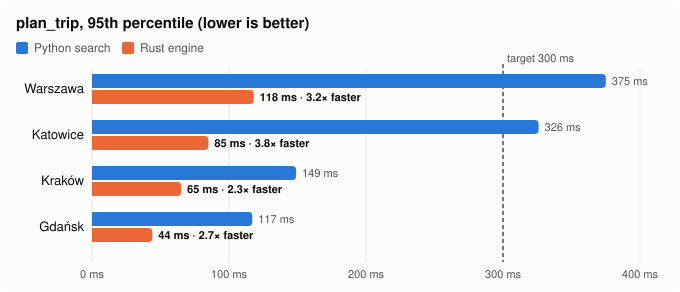
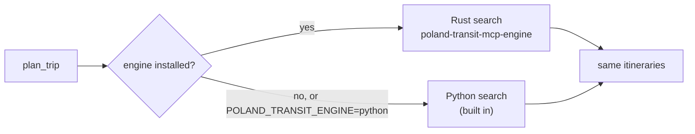

# The optional Rust engine

The trip-planning search ([RAPTOR](https://www.microsoft.com/en-us/research/publication/round-based-public-transit-routing/))
is ported line for line to Rust (`engine/`, package `poland-transit-mcp-engine`). Install the engine and the server
uses it; leave it out and the built-in Python search answers instead. The answers are the same; only the speed
differs.

`plan_trip` p95 in process, 100 plans per city, on a 4-vCPU cloud VM ([CHECKS.md](CHECKS.md#rust-engine-optional)).

## Why Rust

- **It's where the time goes.** In a profile of 40 Warszawa trip plans with the Python search, the search was 85 %
  of the time, and in Python `plan_trip` missed the 300 ms target on Warszawa and Katowice.
- **It's much faster, with the same answers.**
  - Each search runs 17–21× faster in Rust. A whole `plan_trip` also spends time outside the search (walking,
    building the answer), so it is faster by less: in total time over 100 plans, 2.3× on Gdańsk, 3.1× on Warszawa
    and 3.4× on Katowice (p50 25→8, 79→18 and 78→18 ms). Measured with `scripts/compare_engines.py`, in process, on
    an Apple Silicon Mac on 2026-11-17 ([CHECKS.md](CHECKS.md#rust-engine-optional)).
  - Rust and Python answers matched in full on 400 real trip plans and on every acceptance query
    ([CHECKS.md](CHECKS.md)).
- **It runs in parallel.** The engine releases Python's global interpreter lock (GIL), so simultaneous requests over
  HTTP can use every CPU core.
- **Only the search is Rust.** The MCP server, the tools and the data pipeline stay Python.

## Install and check

- From a clone: `uv sync --extra dev --extra fast` (needs a Rust toolchain; see [AGENTS.md](../AGENTS.md), step 3).
- With `uvx`: `--with ./engine` from a clone, or `--with "poland-transit-mcp-engine @ git+…#subdirectory=engine"`.
- The first upload of `poland-transit-mcp-engine` to PyPI is its source only, so `--with poland-transit-mcp-engine`
  from PyPI also builds it from source and needs a Rust toolchain, until prebuilt wheels are published. Publishing
  is an optional, manual step: [PUBLISHING.md](PUBLISHING.md).
- The server prints the search it uses at start (`search engine: rust <version>` or `python`) and reports it in
  `list_cities`. `POLAND_TRANSIT_ENGINE=python` forces the Python search.
- Compare both on your data: `uv run python scripts/compare_engines.py --cities gdansk --plans 100`.

## Measured, end to end

4-vCPU Linux cloud VM, Python 3.13, end to end over MCP, 600 random trips. Full method in
[CHECKS.md](CHECKS.md#weight); between cities in [INTERCITY.md](INTERCITY.md#measured-2026-11-16).

| | With the Rust engine | Python search only | Budget |
|---|---|---|---|
| `plan_trip` p95, Warszawa + Katowice + Kraków | **89 ms** | 377 ms | < 300 ms |
| `plan_trip` p95, Gdańsk + Wrocław + Kraków | **80 ms** | 169 ms | < 300 ms |
| Peak memory, all 8 cities in one process | **432 MB** | 420 MB | ≤ 512 MB |
| Cold start | 0.8–1.0 s | 0.8–1.1 s | ≤ 3 s |
| City files | 5.7 MB (Zakopane) to 129.9 MB (Warszawa); `poland` 14.5–20.6 MB | | ≤ 150 MB each |
| `plan_trip` between cities, p95 (Gdańsk, Kraków, Warszawa + `poland`, 700 MB) | **372 ms** | 2,013 ms | < 1 s |
