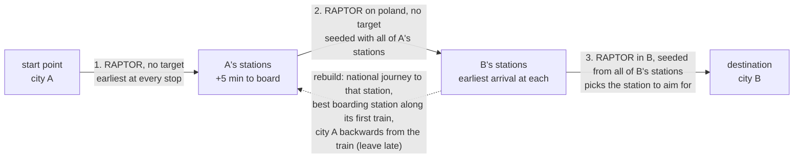

# Travel between cities

Trips from a place in one city to a place in another, by train or coach, with city transport at both
ends. Numbers are *measured* (2026-11-16) unless marked *estimated*.

## What was built

- **`poland.sqlite`** (`poland-transit-mcp build poland --download`): the Polish Trains GTFS and FlixBus's European feed cut to its Polish stops. 14.5 MB and 12 s to build in the run measured here (its size varies with the day's feeds; another build was 20.6 MB), no OSM. See [SOURCES.md](../SOURCES.md) for what each feed holds and what the build changes.
- **Pseudo-city `poland`:**
  - `departures` at a station, with train, category, platform and track.
  - `line_info` for a line, or a train by number or name.
  - `find_places` for stations.
  - Map tools on `poland` say what to use instead.
- **`plan_trip(..., to_city=...)`.** One option per train or coach, up to 3. Every leg names its city and operator; train legs give train, category, platform and track. Answers list the estimated change times under `assumptions`, and a trip to or from Zakopane notes the private coaches that are missing.

## How a trip is planned

The city files stay as they are. `poland.sqlite` holds trains and coaches in the same timetable
format. The two are joined at the national stations inside each city's area, reached on that city's
walking graph. Each layer's search has no target and seeds the next, so a trip costs a handful of
RAPTOR runs, not one per station. Station coverage, straight line ≤ 400 m to a city stop: Gdańsk 30
of 37 stations, Kraków 46 of 65, Wrocław 45 of 61, Poznań 43 of 76, Toruń 12 of 17. The others are
still reachable on foot.

Design details:
- **Two no-target searches.** "Earliest arrival at each station" needed a search that returns arrivals at every stop: `Tables.earliest` in the Rust engine (0.2.0), with the same answers as `raptor_all()` in Python (tested).
- **One option per train.** Further options repeat steps 2–3 with every train or coach boarding after the previous option's, and after it has passed each station of city A. Otherwise the same train comes back, boarded one station further on.
  - An option that leaves earlier, arrives no sooner and changes more often is dropped.
  - Legs are built only for the options kept. That made trips from Warszawa 44 % faster.
- **Boarding station.** A train often stops at several stations of a city. The planner takes the one that lets the traveller leave latest (arrive_by: arrive earliest), with one search seeded from all of them.
- **Walks to and from stations** are offered up to 30 min (city stops: 15 min).
  - A walk wins over transit that saves less than 5 min, as in single-city trips.
  - Without this, Kraków Główny → Rynek Główny (17 min on foot) became a 2-minute train hop plus a walk.
- **Stations are grouped by name** (and a ~1 km cell): every platform and track of Kraków Główny is one station.

## Measured (2026-11-16)

`scripts/measure_intercity.py`: Gdańsk, Kraków and Warszawa plus `poland`, 20 random trips per ordered
pair (120), one in five `arrive_by`, Wednesday 2026-11-18, Rust engine, over MCP on the 4-vCPU VM:

| | Rust, `--memory-budget 700` | Rust, default 480 MB | Python search, 700 MB | Budget |
|---|---|---|---|---|
| Found a train or coach | 126 of 126 | 126 of 126 | 126 of 126 | |
| `plan_trip` p50 / p95 / max | **114 / 372** / 1,045 ms | 234 / 2,583 / 3,070 ms | 859 / 2,013 / 2,249 ms | p95 < 1 s |
| First trip per pair (finds the stations, may load cities) | 0.1–2.0 s | 0.8–2.2 s | 0.6–2.9 s | |
| Peak memory | 573 MB | 532 MB | 650 MB | |

- **The 1 s budget needs the Rust engine.** With the Python search, the one-to-all searches on Warszawa and on the national layer take most of the 2 s.
- **Memory:**
  - The national layer takes 51 MB (estimated) for one day, 3.5× its 14.5 MB file. The pool now reserves 4× the file for it.
  - At the default 480 MB, the three cities and `poland` do not fit, and Warszawa and Kraków were unloaded and reloaded throughout.
  - At start, the server now names the budget that keeps the chosen cities loaded: 650 MB here.

Checks against operator timetables and ten example trips: [CHECKS.md](CHECKS.md), "Trips between cities".

## Limits

- **Change times are estimates:** 5 min between city transport and a train, and 5 min between trains. No minimum connection times are published. Answers list them under `assumptions`.
- **Not in the data:** the private Kraków–Zakopane coaches and minibuses (Szwagropol, Majer, Trans-Kos…), PKS Polonus, Neobus, and fares. Answers for trips to or from Zakopane say so.
- **No live train delays.** mkuran.pl publishes them (`updates.json`, CC BY 4.0); they are not used yet.
- **No prebuilt `poland.sqlite`.** PKP PLK's terms allow it with credit and without resale; Koleje Mazowieckie's terms are still to be read. Build it with `poland-transit-mcp build poland --download`.
- **The rail timetable changes on 13 Dec 2026.** Rebuild the file after that; `as_of` shows each feed's validity.
